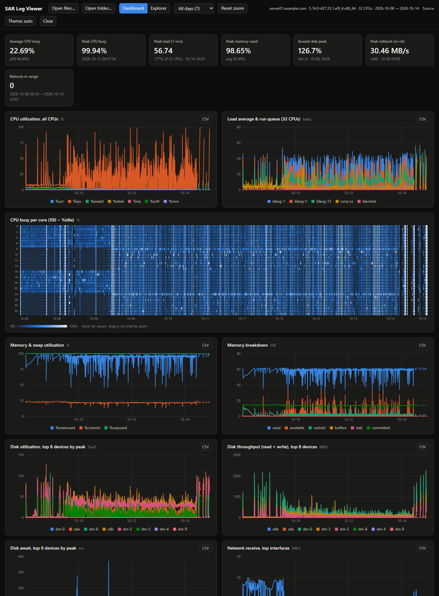

i# SAR Log Viewer

A single-file, offline HTML tool for graphing Linux **sysstat `sar`** reports. Open
`sar-viewer.html` in a browser and drop in your `sar` text files to get a dashboard of CPU,
memory, disk, network and load. Nothing is installed or uploaded.

Part of [sysadmin_tools](https://github.com/roldan-pr/sysadmin_tools).



## Features

- **Dashboard** with summary tiles (average/peak CPU, peak load, peak memory, busiest disk,
  peak network, reboots), updated for the visible time range.
- **Charts**:
  - CPU breakdown and a per-core heatmap
  - Load average and run queue
  - Memory and swap (% and GiB)
  - Disk %util, throughput and await (top 8 devices)
  - Network RX/TX per interface, plus errors and drops when present
  - Context switches, paging, I/O requests and sockets
- **Explorer**: plot any metric from any section of the report, for up to 8 CPUs, devices or
  interfaces at once, with a min/avg/p95/max table.
- **Synced zoom and crosshair**: drag across any chart to zoom all of them; double-click to reset.
  Hovering shows the values at that moment on every chart.
- **Multi-day and multi-host**: load a month of files at once. Pick a single day from the range
  menu. If files come from several servers, a host selector appears.
- **CSV export** for every chart.
- Light and dark themes (follows the OS by default).

## Usage

1. Produce text reports on the server. sysstat usually writes them nightly as
   `/var/log/sa/sarDD`. To convert binary `saDD` files yourself:

   ```sh
   for f in /var/log/sa/sa[0-9]*; do
     LC_ALL=C sar -A -f "$f" > "$(dirname "$f")/sar${f##*/sa}"
   done
   ```

   `LC_ALL=C` gives 24-hour times and `.` decimals. The viewer also handles AM/PM times and `,`
   decimals.

2. Copy the `sarDD` files to your workstation.
3. Open `sar-viewer.html` in a current Chrome, Edge or Firefox.
4. Drag the files onto the page, or use **Open files…** / **Open folder…**. Binary `saDD` files in
   the same folder are skipped automatically.

## Supported input

Text output of `sar` from sysstat 11–12.x (RHEL/CentOS/Rocky/Alma 7–9, Debian, Ubuntu, SLES).
Each file must start with the standard header line:

```
Linux 5.14.0-427.el9.x86_64 (server01.example.com)   2026-10-01   _x86_64_   (32 CPU)
```

Every section that `sar -A` prints is recognised by its column header. Unknown sections still
appear in the Explorer under their column names. `Average:` lines are ignored, and
`LINUX RESTART` markers are counted as reboots.

Times are shown exactly as written in the report (no timezone conversion).

## Security and privacy

- **Fully offline.** The page has no external scripts, fonts or stylesheets. A strict
  `Content-Security-Policy` (`default-src 'none'; connect-src 'none'`) blocks every network
  request, so loaded log data cannot leave the browser.
- **Nothing is stored.** Data lives only in the open tab; closing or reloading the page discards
  it. No cookies or local storage are used.
- **Untrusted input is escaped.** Values from log files (device names, interface names, etc.) are
  HTML-escaped before display. CSV exports guard against spreadsheet formula injection.
- **Share screenshots carefully.** Hostnames, kernel versions and device names from your logs are
  shown on screen. Redact them before sharing screenshots, as was done for the example above.

## License

MIT. See [LICENSE](../LICENSE).
